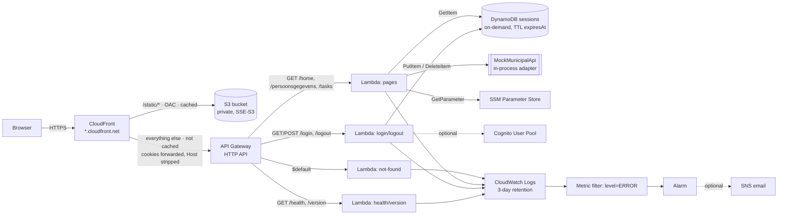

# Mijn Sandbox Portal: learning guide

A step-by-step guide to building a small, cheap AWS app that uses the same core ideas as Mijn Nijmegen. **You write the code.** This guide explains what to build and why, shows the AWS resources involved, and points out the traps. Code snippets show only the parts that are hard to find on your own (gotchas, exact property names). The rest is up to you.

> **Rules for the whole project**
> - Use mock data only. Never connect to BRP, DigiD, payment, benefits or production APIs.
> - Never commit secrets. Never use `*` in IAM actions or resources.
> - Deploy only to `gn-sandbox-indy` (account `956966432757`, `eu-central-1`).
> - Don't import from or change the Mijn Nijmegen repo. You can *read* it to compare (for example `src/ApiFunction.ts`, `src/SessionsTable.ts`, `src/ApiStage.ts`, `src/CloudfrontStack.ts`), but keep this project self-contained.

---

## 0. Where you are now

Here's what you've built so far (commits `8fd6f78` → `e0f3a99`, plus the review fixes from 2026-10-29):

| Phase | Status | Where |
|---|---|---|
| 1. TypeScript + CDK project | ✅ projen `GemeenteNijmegenCdkApp` | `.projenrc.ts`, `src/main.ts` |
| 2. Health-check Lambda + HTTP API | ✅ `/health`, `/version` (version from `APP_VERSION`) | `src/health`, `src/version` |
| 3. Server-rendered pages + local server | ✅ `/` → `/home`, shared layout (header, nav, footer partials), `npx projen dev` | `src/home`, `src/app/render.ts`, `src/local/`, `templates/` |
| 4. S3 static assets | ✅ bucket + upload under `static/`, logo in the header. Browsers reach them in phase 9 (CloudFront); locally they already work | `static/`, `src/SandboxPortalStack.ts` |

### Phase 1–4 review (2026-10-29)

Checked: `npx projen build` (synth + jest + eslint) passes, and the local server returns the right status and content type for `/`, `/home`, `/health`, `/version`, `/static/*` and an unknown path.

Fixed during the review:
- **`npx projen` hadn't run after editing `.projenrc.ts`.** So `.local/` wasn't in `.gitignore` yet (it would have been committed) and `npx projen dev` didn't exist. **Run `npx projen` after every `.projenrc.ts` change.**
- **Exercise 1–2:** `/version` now reads `process.env.APP_VERSION`, which the stack sets from `Statics.appVersion`. Locally the server sets `APP_VERSION=local`.
- **Exercise 3:** `GET /` now redirects (`302`) to `/home` instead of rendering the same page under two URLs. `/` and `/home` share one `HttpLambdaIntegration`, so the template has 3 integrations instead of 4. The nav menu is now the `templates/nav.mustache` partial, included from the header. The local server route table has `GET /` too.
- **Exercise 4:** `static/logo.svg` added and shown in the header.
- **`render()` fills in `renderedAt`**, because the footer needs it on every page and a new handler could forget it.
- **`robots.txt`:** `/profile` → `/persoonsgegevens`, to match phase 7.

Still to do yourself:
- **Deploy and check.** Your SSO session had expired during the review, so the deployed state wasn't checked. Run `aws sso login --profile gn-sandbox-indy`, then `npx cdk diff SandboxPortalStack --profile gn-sandbox-indy`. If you haven't deployed since 2026-10-27, the diff still removes the old `sessions` table (0 items). Then deploy and finish exercise 4 with `aws s3 ls s3://<bucket>/static/ --profile gn-sandbox-indy`. You should see `logo.svg`.
- **Commit** before deploying, so `git log` matches what runs in AWS.
- **`robots.txt` is served at `/static/robots.txt`**, but crawlers only look at `/robots.txt`. Fix it in phase 9 with a CloudFront behavior for `/robots.txt`. Also remember that `Disallow` is a request to polite crawlers, not access control. It even lists your paths publicly.

### Fix these before you continue

Review status, checked on 2026-10-27 against your uncommitted changes (flat layout):

1. ✅ **`test/main.test.ts`** now builds a `SandboxPortalStack` with `getEnvironmentConfiguration('development')`. It passes. Phase 8 explains how to replace the snapshot with real assertions.
2. ✅ **Log groups survive `cdk destroy`.** All four log groups now have `removalPolicy: RemovalPolicy.DESTROY` (synth shows `DeletionPolicy: Delete`).
3. ✅ **Helper Lambda log groups.** `BucketDeployment` now has its own log group with 3-day retention. The `autoDeleteObjects` provider Lambda can't take a `logGroup`, so its group (`/aws/lambda/SandboxPortalStack-CustomS3AutoDeleteObjects...`) still has no retention. The `contains(logGroupName,'SandboxPortal')` query in [Cleanup](#destroy-and-cleanup-procedure) finds it, so delete it there after a destroy.
4. ✅ **`destinationKeyPrefix: 'static/'`** is set (synth shows `DestinationBucketKeyPrefix: static/`). `/static/style.css` keeps returning 404 until phase 9 (CloudFront). That's expected.
5. ✅ **`{{greeting}}`** no longer contains HTML. The `<strong>` and `<b>` written directly in `home.mustache` are fine: that's markup you control, not data. Remember: `{{x}}` escapes and `{{{x}}}` does not. **Never use `{{{ }}}` for data that came from a user or an external API.**
6. ℹ️ **Always name the stack when you deploy.** `src/main.ts` also creates `PipelineStack`. If you run `cdk deploy --all`, CDK will try to create a CodePipeline (it costs money, and the `connectionArn` parameter it needs will fail the deploy). It also creates a **KMS key (~$1/month)** because of `crossAccountKeys: true`. Use `npx cdk deploy SandboxPortalStack`.
7. ℹ️ **Repo path.** This guide assumes the repo is at `/Users/indyk/repos/pub/mijn-nieuwe-project`.
8. ✅ **Paths after the move to the flat layout.** The handler `entry` paths are now `${__dirname}/<route>/index.ts`, and `src/home/index.ts` imports `'../../templates/home.mustache'`. `npx projen test` passes (jest + eslint).
9. ℹ️ **The snapshot test can't fail yet.** Projen's `test` task runs `jest --updateSnapshot`, so a changed template is quietly written as the new snapshot ("1 snapshot updated"), and `test/__snapshots__/` is gitignored. Treat it as a smoke test (does the stack synth?) and add real `Template.hasResourceProperties(...)` assertions in phase 8.
10. ℹ️ **The `ts-jest` warning `TS151002` (hybrid module kind)** is harmless. It comes from projen's generated tsconfig, so leave it.

### Project layout: flat, like Mijn Nijmegen

This project uses projen's default flat `src/` layout, the same convention as Mijn Nijmegen and other Gemeente Nijmegen repos. Projen compiles `src/` into a root-level `lib/` folder (gitignored as `/lib`), so never put source files in the root `lib/`.

| What | Where |
|---|---|
| CDK entry point | `src/main.ts` (projen's default, so `cdk.json` needs no changes) |
| Stacks, stages | `src/*Stack.ts`, `src/*Stage.ts` |
| Reusable constructs (new) | `src/constructs/` |
| Lambda handlers | `src/<route>/index.ts` (`src/health`, `src/version`, `src/home`, ...) |
| Shared app logic (new) | `src/app/` (render helper, sessions, mock API, logger) |
| Config | `src/Configuration.ts`, `src/Statics.ts` |
| Templates, static files, tests | `templates/`, `static/`, `test/` at the root |

> **Keep it readable as it grows.** In a flat layout, handler folders sit next to `app/`, `constructs/`, `local/` and `types/`. Name handler folders after their route only, and never put CDK code inside a handler folder: esbuild bundles everything a handler imports.
>
> **Path gotcha:** `${__dirname}` in `src/SandboxPortalStack.ts` is `src/`. Handlers are at `${__dirname}/<route>/index.ts`, and `static/` is at `${__dirname}/../static`. From `src/<route>/index.ts`, templates are at `../../templates/`.

> **Projen rule:** never edit `package.json`, `tsconfig.json` or `.projen/*` by hand. To add a dependency, add it to `deps` or `devDeps` in `.projenrc.ts` and run `npx projen`.

---

## Core concepts, quick version

These come back in every phase. Each phase goes deeper where it matters.

**Infrastructure as code (1).** `src/SandboxPortalStack.ts` is a TypeScript program. `cdk synth` *runs* that program, and the result is a CloudFormation template (JSON) in `cdk.out/`. CloudFormation, not CDK, creates the resources in AWS. Open `cdk.out/SandboxPortalStack.template.json` once and find your `AWS::Lambda::Function`. Everything else is a convenience layer on top of that file.

**Constructs, stacks, stages (2).**
- A *construct* is any building block, from one bucket to a whole "Lambda with log group and alarm" bundle.
- A *stack* is a group of constructs that is deployed as **one** CloudFormation stack. They're created, updated and deleted together.
- A *stage* is a group of stacks that make up one complete environment (dev, accp, prod).

Mijn Nijmegen has `ApiStage` containing `ApiStack`, `SessionsStack`, `CloudfrontStack` and more, and the pipeline deploys the stage. You'll do the same in phase 11.

**Serverless (3).** You never pick an instance size or patch an OS:
- API Gateway, Lambda, DynamoDB on-demand, S3 and CloudFront all scale with requests.
- You pay per request or per GB.
- They cost (almost) nothing when idle.

The trade-offs are cold starts, execution time limits, and less control over the runtime.

---

## Phase 1–2 recap: CDK project, health check, routing

**Concepts:** 1, 2, 4, 5, 19, 21.

**API Gateway routing (4).** In an HTTP API, a *route* is `METHOD /path` → *integration* (your Lambda). `httpApi.addRoutes({ path: '/health', methods: [GET], integration })` creates three things:
- an `AWS::ApiGatewayV2::Route`
- an `AWS::ApiGatewayV2::Integration`
- an `AWS::Lambda::Permission` that lets API Gateway invoke the function. Look for it in the synthesized template. This is the hidden resource most people don't know about.

**Lambda handlers (5).**
- **Event input:** for HTTP API (payload v2) the event is `APIGatewayProxyEventV2`. It contains `rawPath`, `requestContext.http.method`, `headers`, `cookies?: string[]`, `queryStringParameters`, `body` and `isBase64Encoded`.
- **Response output:** `{ statusCode, headers, body, cookies? }`. If you return a plain object or string, API Gateway turns it into a JSON 200 response. Always return the full shape.
- **Stateless:** a different container may handle each request. Never keep user state in module variables. Caching *non-user* data there (config, SDK clients) is fine and recommended.
- **Timeout / memory:** you set `timeout: 5s` and `memorySize: 256`. CPU scales with memory. Keep the Lambda timeout *lower* than API Gateway's 30 s integration limit.
- **Environment variables:** non-secret configuration that is fixed at deploy time.
- **Cold start:** the first request on a new container loads your bundle and runs top-level code (~100–300 ms for Node). Small bundles mean faster cold starts.

**Bundling (19).** `NodejsFunction` runs **esbuild** during `cdk synth`. Esbuild follows your `import`s, compiles TS to JS, and writes one `index.js` per function into `cdk.out/asset.<hash>/`. CDK zips that folder and uploads it to the bootstrap bucket. Points to know:
- On Node 18+ runtimes, `@aws-sdk/*` is **external** by default because the Lambda runtime already ships it.
- The `.mustache` text loader you configured inlines templates into the bundle.
- If `esbuild` is installed locally (it is, as a devDep), no Docker is needed.
- Inspect a bundle: `ls cdk.out/asset.*` and open an `index.js`.

**Deployment lifecycle (21).**

```bash
aws sso login --profile gn-sandbox-indy
# One time per account/region. The GN landing zone may already be bootstrapped.
# Check first and ask your team before re-bootstrapping a shared account:
aws cloudformation describe-stacks --stack-name CDKToolkit --profile gn-sandbox-indy
npx cdk bootstrap aws://956966432757/eu-central-1 --profile gn-sandbox-indy   # only if missing

npx cdk synth SandboxPortalStack          # run the TS program → cdk.out/*.template.json
npx cdk diff  SandboxPortalStack --profile gn-sandbox-indy   # what WILL change (read this every time!)
npx cdk deploy SandboxPortalStack --profile gn-sandbox-indy  # shows IAM changes and asks for approval
npx cdk destroy SandboxPortalStack --profile gn-sandbox-indy
```

`cdk bootstrap` creates the `CDKToolkit` stack: an S3 bucket for assets, an ECR repo, and IAM roles that CDK uses to deploy. **Read the `cdk diff` output before every deploy.** Look in particular for `[-]` (removal) and `[~] ... replace` (resource gets replaced, which means data loss for tables and buckets).

> **Exercise 1–2:** Make `/version` return the version from an environment variable `APP_VERSION` set in the stack (for example from `package.json`) instead of a hardcoded string. Run `cdk diff` and confirm that only the Lambda's environment changes.

---

## Phase 3: Server-rendered HTML (recap + local running)

**Concept 6, server-side rendering.** Lambda returns `content-type: text/html` and a finished HTML string. The browser needs no JavaScript framework. Mijn Nijmegen works the same way. The pros: simple, fast first paint, works without JS, and no API tokens in the browser. The cost: every page view is a Lambda invocation.

### Build next: a shared layout

Every page needs the same `<head>`, header and footer. Use **Mustache partials**:
- `templates/header.mustache`, `templates/nav.mustache` and `templates/footer.mustache`
- render with `Mustache.render(pageTpl, view, { header: headerTpl, nav: navTpl, footer: footerTpl })`
- include them in the page with `{{> header}}` (the header includes `{{> nav}}`)

Put the render helper in `src/app/render.ts` so all handlers share it.

### Build next: run it locally

A tiny local HTTP server that converts Node requests into `APIGatewayProxyEventV2` events and calls your real handlers lets you iterate fast:

- File: `src/local/server.ts`
- Use `node:http`, a `Record<string, handler>` route table that mirrors the stack, and serve `static/` for `/static/*`.
- Build the event with at least `rawPath`, `requestContext.http.method`, `requestContext.requestId`, `headers`, `cookies` (split the `cookie` header on `; `), `body` and `isBase64Encoded: false`.
- Write the result back: `statusCode`, `headers`, `cookies` → one `Set-Cookie` header per cookie, and `body`.

**Gotcha:** `ts-node` can't import `.mustache` files. Run it through esbuild with the same loader the Lambdas use. You learn bundling for free:

```bash
npx esbuild src/local/server.ts --bundle --platform=node --loader:.mustache=text --outfile=.local/server.js && node .local/server.js
```

Add `.local/` to `.gitignore` through `.projenrc.ts` (`project.gitignore.exclude('.local/')`), and add a projen task `dev` that runs the command above (`project.addTask('dev', { exec: '...' })`).

> **Exercise 3:** Add a `/` route that redirects (`302`, header `location: /home`) to the home page. Then add a mustache partial for the navigation menu.

---

## Phase 4: Static assets in S3 (recap)

**Concept 7, static vs dynamic.** CSS, images, fonts and `robots.txt` are the same for every user and rarely change. S3 stores them and CloudFront caches them at the edge (fractions of a cent, no compute). HTML that depends on *who* is logged in must be generated per request, so it comes from Lambda. Mixing the two (serving CSS from Lambda) wastes invocations and makes caching harder.

**Resources:** `AWS::S3::Bucket` (private, SSE-S3, SSL-only), `Custom::CDKBucketDeployment` with a helper Lambda.

You've already done the important part: **the bucket is private**. CloudFront will read it through an *Origin Access Control* in phase 9.

> **Exercise 4:** Add a `static/logo.svg` and reference it from the header partial. Then run `aws s3 ls s3://<bucket>/static/ --profile gn-sandbox-indy` after deploying to check the key prefix.

---

## Phase 5: DynamoDB sessions and secure cookies

**Concepts:** 9, 10, 12, 20.

### Why
HTTP is stateless and Lambda is stateless, so the app needs to remember "this browser is logged in as persona X" *somewhere*. That place is a DynamoDB table. The browser only gets a random, meaningless ID in a cookie.

**Why not put the data in the cookie?**
- Cookies end up in browser storage, proxies, screenshots and bug reports.
- Base64 is not encryption.
- You can't revoke a cookie that holds the data itself, but you *can* delete a session row.

An **opaque** identifier reveals nothing, and deleting the server-side row instantly logs the user out.

### DynamoDB concepts (10)
- **Item vs row:** an item is a schemaless bag of attributes. Only the key is mandatory, and two items in the same table can have completely different attributes. A relational table has fixed columns and supports joins. DynamoDB has no joins: you design the table around your *access pattern* ("get session by ID").
- **Partition key:** `sessionId` (string). DynamoDB hashes it to decide where the item is stored. A lookup by key is O(1), single-digit milliseconds. You don't need a sort key here.
- **On-demand billing:** `BillingMode.PAY_PER_REQUEST`. You pay per read and write, with no capacity planning and $0 when idle.
- **TTL:** set `timeToLiveAttribute: 'expiresAt'` and store a Unix timestamp **in seconds**. DynamoDB deletes expired items *eventually* (often within minutes, but it can take up to a couple of days). **So the code must also check `expiresAt` itself.** TTL is housekeeping, not security.
- **Encryption at rest:** always on. The default AWS-owned key is free. `AWS_MANAGED` adds KMS request costs and `CUSTOMER_MANAGED` adds $1/month. Keep the default.
- **Not public:** DynamoDB has no public endpoint concept like S3. Access goes only through IAM-signed API calls. Least privilege (below) is what protects it.

### Resources to add (`src/SandboxPortalStack.ts`, or better a `SessionsTable` construct in `src/constructs/`)
- `AWS::DynamoDB::Table` with partition key `sessionId` (S), `PAY_PER_REQUEST`, TTL attribute `expiresAt`, `removalPolicy: DESTROY` (sandbox only. In production you'd use RETAIN plus point-in-time recovery).
- Environment variable `SESSION_TABLE_NAME` on each Lambda that needs sessions.

### Least privilege (12)
`table.grantReadWriteData(fn)` is convenient, but it also grants `Scan`, `Query`, `BatchWriteItem` and more. A session Lambda only needs a few actions. Write the policy explicitly:

```ts
fn.addToRolePolicy(new PolicyStatement({
  actions: ['dynamodb:GetItem', 'dynamodb:PutItem', 'dynamodb:DeleteItem'],
  resources: [table.tableArn],
}));
```

After `cdk synth`, find the `AWS::IAM::Policy` in the template and check that it lists exactly these actions on exactly this ARN. Some Lambdas (for example `/health`) don't touch sessions at all, so they get **no** DynamoDB permissions.

### Application code to write (`src/app/session/`)
Design it behind an **interface**. This is the most important design decision in this phase, because it makes the code testable and runnable locally:

```ts
export interface SessionStore {
  get(sessionId: string): Promise<Session | undefined>;
  put(session: Session): Promise<void>;
  delete(sessionId: string): Promise<void>;
}
```

- `DynamoSessionStore`: uses `@aws-sdk/lib-dynamodb` (`DynamoDBDocumentClient`, `GetCommand`, `PutCommand`, `DeleteCommand`). Create the client **outside** the handler so warm invocations reuse it.
- `InMemorySessionStore`: a `Map`, for local runs and unit tests.
- `SessionService`: `create(userId)`, `load(event)` (reads the cookie, fetches the item, **checks `expiresAt > now`**, otherwise treats the session as missing), `destroy(sessionId)`.
- Session ID: `crypto.randomBytes(32).toString('base64url')`, which is 256 bits of randomness. **Never** use `Math.random()` or a UUID v1.
- Session item: `{ sessionId, userId, createdAt, expiresAt }`. **Store only a pseudonymous `userId`**, never a name, BSN or address. Fetch profile data when needed (phase 7).

Add deps in `.projenrc.ts`: `deps: [..., '@aws-sdk/client-dynamodb', '@aws-sdk/lib-dynamodb']`, then run `npx projen`.

### The cookie
```
Set-Cookie: session=<id>; HttpOnly; Secure; SameSite=Lax; Path=/; Max-Age=900
```
| Attribute | Why |
|---|---|
| `HttpOnly` | JavaScript can't read it, so an XSS bug can't steal the session |
| `Secure` | only sent over HTTPS (browsers make an exception for `localhost`) |
| `SameSite=Lax` | not sent on cross-site POSTs, which is the main CSRF protection |
| `Path=/` | sent for the whole site |
| `Max-Age=900` | 15 minutes. Match it to `expiresAt` |

Optional extra: name it `__Host-session`. Browsers then *require* `Secure`, `Path=/` and no `Domain`.

**HTTP API gotchas:**
- Incoming cookies are in `event.cookies` (an array of `"name=value"`), **not** in `event.headers.cookie`.
- To set cookies, return `cookies: ['session=...; HttpOnly; ...']` in the response object.
- Make `Secure` configurable (`COOKIE_SECURE=false` only for the local server). Deployed environments are always HTTPS, even the default `execute-api` URL.

**Local:** the local server uses `InMemorySessionStore`. Choose it with an env var such as `SESSION_STORE=memory`. A single factory function `createSessionStore()` reads that env var.

**Test:** unit-test `SessionService` with `InMemorySessionStore` and a fake clock (inject `now: () => number`):
- create → load returns the session
- an expired session → returns undefined
- destroy → returns undefined
- a missing cookie → undefined
- a garbage cookie value → undefined, not a crash

**Cost:** DynamoDB on-demand is about $1.4 per million writes and $0.28 per million reads in eu-central-1, and the first 25 GB of storage is free. A learning project costs **< $0.01/month**. **Risk:** none at idle.

> **Exercise 5:** Store `sha256(sessionId)` as the partition key instead of the raw ID. Then a leaked table dump (or a log line) can't be used to hijack sessions. What has to change in `get` and `delete`?

---

## Phase 6: Mock login and logout

**Concepts:** 11, 14, 20.

### Authentication vs authorization (11)
- **Authentication:** *who are you?* Proven by DigiD in Mijn Nijmegen (through OpenID Connect), by a mock form here, by Cognito in phase 10.
- **Authorization:** *what are you allowed to do?* For example "you can only see *your own* cases". Even with perfect authentication, a route that returns `cases?userId=...` from a query parameter instead of from the session is an authorization bug.

### ⚠️ Mock authentication is NOT production-safe
The mock login lets anyone become any persona **without proving anything**. That's fine for learning with fake data. Label it on the page itself ("DEMO LOGIN – not real authentication") and put a comment in the code. Never deploy this pattern where real data exists.

### Build
- `GET /login`: renders a form with a `<select>` of mock personas (`persona-1`, `persona-2`, `persona-3`). **No passwords**, because a hardcoded demo password is still a hardcoded secret and teaches a bad habit.
- `POST /login`: parses the form, validates `personaId` against the known list (see Zod, phase 8, or a simple allow-list check for now), **creates a new session** (always a new ID: that prevents *session fixation*), sets the cookie, and redirects `302` → `/home`.
- `GET /logout` (or better `POST /logout` from a form button): deletes the DynamoDB item, sets `session=; Max-Age=0; ...` to clear the cookie, and redirects → `/login`.

**HTTP API gotcha: form bodies arrive base64-encoded.** A `POST` with `application/x-www-form-urlencoded` typically has `isBase64Encoded: true`:

```ts
const raw = event.isBase64Encoded ? Buffer.from(event.body ?? '', 'base64').toString('utf8') : (event.body ?? '');
const form = new URLSearchParams(raw);
```

**Routes and resources:** three new routes (`GET /login`, `POST /login`, `GET|POST /logout`). One Lambda can serve `GET` and `POST /login` by branching on `event.requestContext.http.method`. **IAM:** login needs `PutItem` only, logout needs `DeleteItem` only. Show it in the policy.

**Test:**
- Handler tests (phase 8) call the handler directly with a fake event:
  - a POST with a valid persona → expect 302 and a `cookies[0]` that contains `HttpOnly`
  - an invalid persona → 400 with an HTML error page
- Manually: in the browser dev tools, check the Application → Cookies flags.

**Cost:** two extra Lambda functions, $0 idle.

> **Exercise 6:** Add `?returnTo=/tasks` support so that after logging in you land where you came from. Then think about this: what if someone sends a victim `/login?returnTo=https://evil.example`? Allow only relative paths that start with `/` and not with `//`. That is the open-redirect vulnerability, and you just prevented it.

---

## Phase 7: Protected pages: personal data and tasks

**Concepts:** 11, 15, 16, 20.

### Build
- A helper `requireSession(event)` that returns the session or a `302 → /login` response. Every protected handler calls it first. (In Mijn Nijmegen every protected `ApiFunction` handler does the same thing.)
- `GET /home`: now greets the persona by display name (fetched from the mock API, **not** stored in the session).
- `GET /persoonsgegevens` (personal data): renders a profile from the mock API.
- `GET /tasks`: renders a list of mock cases or tasks.
- Mock data: `src/app/mock-data/personas.ts` with **obviously fake** values: names like "Test Persoon", BSN-like fields as `000000000` or omitted, addresses like "Voorbeeldstraat 1". No real-looking BSNs.

### External API integration (15): the mock adapter
In Mijn Nijmegen, data comes from external systems (BRP, Zaken, ...). Put that behind an interface:

```ts
export interface MunicipalApi {
  getProfile(userId: string): Promise<Profile>;
  getTasks(userId: string): Promise<Task[]>;
}
```

`MockMunicipalApi` implements it with:
- **Simulated latency:** `await sleep(random 50–300 ms)`.
- **Configurable failure rate:** for example env var `MOCK_API_FAILURE_RATE=0.1`. It throws, or returns malformed data, so you can practise error handling.
- **A timeout:** wrap every call in a timeout (`Promise.race` with a timer, or `AbortSignal.timeout(ms)` for real `fetch`). Keep it well below the Lambda timeout so you can still render a friendly page.
- **Retries:** retry only *idempotent* reads, at most 1–2 times, with backoff (100 ms, 300 ms). Never retry a POST that might have succeeded. Retries multiply load on an already struggling dependency, so keep them few.
- **Errors as types:** throw `DependencyUnavailableError`, and have the handler map it to a **503 friendly page** ("Uw taken zijn tijdelijk niet beschikbaar"). Don't map it to a generic 500.

Because handlers depend on the *interface*, swapping in a real HTTP client later changes one factory function, not every handler. Unit tests inject a fake.

### Authorization in practice
Handlers take `userId` **from the session only**, never from the URL or the form.

> **Exercise 7a:** Add `GET /tasks/{id}`. The mock API returns tasks for all personas. Make sure that persona-1 opening persona-2's task ID gets a 404 (not a 403: don't reveal that it exists). Write the test first.

### Feature flag (16)
Show the tasks page only in development.
- Add `featureTasksPage: boolean` to `Configuration` in `src/Configuration.ts` (`true` for `development`).
- Pass it as the env var `FEATURE_TASKS_PAGE=true|false` to the tasks Lambda and the layout (to hide the menu link).
- The handler returns the 404 page when the flag is off.

**Configuration vs business logic:** "who can see task X" is business logic and lives in code with tests. "Is the tasks page switched on in this environment" is configuration and lives per environment, outside the logic. The same build artifact should run everywhere with different config.

Two levels of flag, and both are valid:
- **Infra flag:** don't even create the route (`if (config.featureTasksPage) httpApi.addRoutes(...)`). Changing it needs a deploy.
- **Runtime flag:** the route exists and the handler checks the flag. You could later read it from Parameter Store without a deploy.

**Cost:** more Lambdas and routes, still $0 idle.

> **Exercise 7b:** Add a `production` entry in `Configuration.ts` (same sandbox account for now) with `featureTasksPage: false`. Run `BRANCH_NAME=production npx cdk synth` and check that the tasks env var is `false`.

---

## Phase 8: Validation, logging, error handling, tests

**Concepts:** 13, 14, 17, 18, 20.

### Input validation with Zod (14)
TypeScript types **disappear at runtime**. `const body = JSON.parse(x) as LoginForm` is a *promise to the compiler*, not a check. Anything from outside your process can be anything: request bodies, cookies, query strings, DynamoDB items, API responses. So:

- Add `zod` to `deps` in `.projenrc.ts`.
- Define schemas and derive types from them: `const LoginForm = z.object({ personaId: z.enum(['persona-1', ...]) }); type LoginForm = z.infer<typeof LoginForm>;`
- Validate:
  - login form input → 400 page on failure
  - the session item loaded from DynamoDB → treat as "no session" on failure
  - **every mock API response** → `DependencyUnavailableError` on failure (an external system sending garbage is an outage, not a crash)
- Use `safeParse` and handle the error branch explicitly.

### Friendly error pages
- `templates/error.mustache` with a title, a human message and a **request ID** ("give this code to support"). Never show a stack trace.
- `src/app/errors.ts` with a function `errorResponse(status, message, requestId)`.
- A wrapper `withErrorHandling(handler)` that catches everything, logs it, and returns 500 (or 503 for `DependencyUnavailableError`).
- **Unknown routes:** by default the HTTP API returns `{"message":"Not Found"}` JSON. Set `defaultIntegration` on the `HttpApi` (the `$default` route) to a small `not-found` Lambda that renders a friendly 404 page.

### Structured logging and observability (17)
- **Logs:** what happened for *one* request. Use JSON so you can query them.
- **Metrics:** numbers over time (errors per 5 min, latency p95).
- **Alarms:** watch a metric and notify someone when it crosses a threshold.

Build:
- `src/app/logger.ts`: `log.info(msg, fields)` / `log.error(...)` that writes one JSON line with `level`, `msg`, `requestId`, plus extra fields. Respect `LOG_LEVEL`. (Alternative: Powertools for AWS Lambda's `Logger`. Look at what it does before you adopt it.)
- **Privacy rule:** never log session IDs, cookie headers, names, addresses or full request bodies. Log `userId` (pseudonymous) at most, plus route, status and duration. Lambda also logs uncaught errors automatically, which is one more reason to catch them yourself.
- CloudWatch resources:
  - `MetricFilter` on each log group: `FilterPattern.stringValue('$.level', '=', 'ERROR')` → metric `SandboxPortal/AppErrors`, value `1`.
  - `Alarm` on that metric (or the built-in `fn.metricErrors()`): `threshold: 1`, `evaluationPeriods: 1`, period 5 minutes, `treatMissingData: NOT_BREACHING`.
  - Optional: an SNS topic with an email subscription as the alarm action (confirm the email after deploying).

**Try it:** set `MOCK_API_FAILURE_RATE=1`, deploy, load `/tasks` a few times, and watch the alarm go to `ALARM` in the console. Query in **Logs Insights**:
```
fields @timestamp, level, msg, requestId | filter level = "ERROR" | sort @timestamp desc
```

### Secrets and configuration (13)
| Kind | Example | Where |
|---|---|---|
| Static, non-secret, per environment | log level, feature flag, table name | `Configuration.ts` → env var |
| Non-secret, changeable without a code change | mock API timeout, failure rate | **SSM Parameter Store** (Standard tier, free) |
| Secret | OAuth client secret, API key | **Secrets Manager** (~$0.40/secret/month) |

**Never commit** a secret to git. That includes `.env` files and test fixtures: git history is forever, and public repos get scanned by bots within minutes. Env vars are visible to anyone with `lambda:GetFunctionConfiguration` and appear in CloudFormation templates, so **secrets don't go in env vars either**. Fetch them at runtime and cache them in a module variable.

Build: create a `StringParameter` `/mijn-sandbox-portal/mock-api/timeout-ms`. Pass its *name* as an env var, read it at runtime with `@aws-sdk/client-ssm` `GetParameterCommand`, and cache it for ~5 minutes. Grant with `param.grantRead(fn)` and check the policy: it's scoped to that one parameter ARN. There's no real secret in this app yet, so **don't create a Secrets Manager secret yet**. Phase 10 might need one.

### Testing (18)
| Type | What | Where |
|---|---|---|
| Unit | `SessionService`, cookie parse/serialize, Zod schemas, retry/timeout helper, authorization ("can't see another persona's task") | `test/app/*.test.ts` |
| Handler (API) | call `handler(fakeEvent)` with injected `InMemorySessionStore` and a fake `MunicipalApi`, assert status, headers, cookies and HTML content | `test/lambda/*.test.ts` |
| CDK assertions | table is `PAY_PER_REQUEST` with TTL `expiresAt`, bucket blocks public access, log groups have retention, each IAM policy has only the expected actions, alarm exists | `test/infra/*.test.ts` |
| Browser (Playwright) | login → home → tasks → logout against the local server or the deployed URL | `test/e2e/*.e2e.ts` |

Tips:
- **Jest can't import `.mustache` either.** Add a small transformer (for example `test/mustache-transformer.js` that returns `module.exports = ${JSON.stringify(source)}`) and register it in `.projenrc.ts` with `jestOptions.jestConfig.transform` for `'\\.mustache$'`. After `npx projen`, check that `package.json` → `jest.transform` still contains the `ts-jest` entry.
- Prefer `Template.fromStack(stack).hasResourceProperties('AWS::DynamoDB::Table', { BillingMode: 'PAY_PER_REQUEST', TimeToLiveSpecification: { AttributeName: 'expiresAt', Enabled: true } })` over snapshots. Snapshots change whenever a bundle hash changes, so people learn to blindly update them.
- To make handlers testable, export a `createHandler(deps)` function plus `export const handler = createHandler(defaultDeps())`.
- Playwright: add `@playwright/test` as a devDep and set `testMatch: '**/*.e2e.ts'` in `playwright.config.ts` (Jest's pattern already picks up `*.test.ts` and `*.spec.ts`, so use a different suffix). Use `BASE_URL` to switch between local and deployed. Mijn Nijmegen has a `playwright.config.ts` you can compare with.

**Cost:** metric filter is free, one custom metric is ~$0.30/month, one alarm is $0.10/month (the first 10 alarms are free tier), Parameter Store Standard is free.

> **Exercise 8:** Add a CDK assertion test that fails if *any* IAM policy in the stack contains `"Action": "*"` or `"Resource": "*"`. Hint: `template.findResources('AWS::IAM::Policy')`. You may find that CDK's own helper Lambdas break this rule. Decide how to handle that and write down why.

---

## Phase 9: CloudFront (only after the API works)

**Concept 8.**

### Why
- **One domain** for HTML and CSS (`/static/*`). Cookies and relative URLs just work.
- **HTTPS** with an AWS certificate on `*.cloudfront.net` at no cost.
- **Edge caching** of static files close to users.
- A **private S3 bucket**: only CloudFront can read it.
- Later: WAF, a custom domain and security headers attach here. Mijn Nijmegen's `CloudfrontStack` does all of these.

### Concepts
- **Origin:** where CloudFront fetches content from. You'll have two: the API Gateway domain and the S3 bucket.
- **Behavior:** a path pattern → origin + cache rules. `/static/*` → S3 (cache aggressively). Default `*` → API (**no caching**, because pages are personal).
- **Cache policy:** what makes up the cache key and the TTL. **Origin request policy:** which headers, cookies and query strings are forwarded to the origin.
- **OAC (Origin Access Control):** CloudFront signs its S3 requests. The bucket policy allows only that distribution.

### Resources (`aws-cdk-lib/aws-cloudfront`, `aws-cloudfront-origins`)
- `Distribution` with:
  - `defaultBehavior`: `origin: new HttpOrigin(apiDomain)`, `allowedMethods: ALLOW_ALL`, `cachePolicy: CachePolicy.CACHING_DISABLED`, `originRequestPolicy: OriginRequestPolicy.ALL_VIEWER_EXCEPT_HOST_HEADER`, `viewerProtocolPolicy: REDIRECT_TO_HTTPS`
  - `additionalBehaviors['/static/*']`: `origin: S3BucketOrigin.withOriginAccessControl(bucket)`, `cachePolicy: CACHING_OPTIMIZED`
  - `priceClass: PriceClass.PRICE_CLASS_100` (EU + North America edges only, cheapest)
- New output: the distribution's `https://<id>.cloudfront.net` URL.

**Gotchas:**
- `httpApi.apiEndpoint` is `https://abc123.execute-api.eu-central-1.amazonaws.com`, but `HttpOrigin` wants only the domain. Use `Fn.select(2, Fn.split('/', httpApi.apiEndpoint))`. The value is a CloudFormation token, so you can't use JS `.split()`. That's a good illustration of synth-time vs deploy-time values.
- **Don't forward the `Host` header to API Gateway**, or it returns 403 because it doesn't recognize `*.cloudfront.net`. That's why it's `ALL_VIEWER_EXCEPT_HOST_HEADER`.
- **Don't cache HTML.** A cached page with persona-1's name served to persona-2 is a data leak.
- Use CloudFront's `errorResponses` with care: they apply to the API origin too. Keep rendering error pages in Lambda.
- The first deploy of a distribution takes 3–10 minutes. `cdk destroy` also waits for it to disable.
- Always use the CloudFront URL from now on. Cookies set on the `execute-api` domain don't carry over.

**Exercise 9a:** Add a `ResponseHeadersPolicy` with security headers (HSTS, `X-Content-Type-Options`, `Content-Security-Policy: default-src 'self'`, `Referrer-Policy`). Check them with `curl -I`.

**Exercise 9b:** The `execute-api` URL is still publicly reachable and bypasses CloudFront. Research two ways to restrict that and their trade-offs. Don't implement them yet.

**Cost:** CloudFront's always-free tier is 1 TB of transfer and 10M requests/month. A learning project: **$0**. Risk: low. The distribution itself has no hourly fee.

---

## Phase 10 (optional): Amazon Cognito authentication

**Concept 11, deeper.** This replaces the mock login with a real OpenID Connect flow, the same *shape* as DigiD-via-OIDC in Mijn Nijmegen:

1. `/login` redirects to the Cognito hosted login page with `state` + PKCE `code_challenge`.
2. The user authenticates *at Cognito*. Your app never sees the password.
3. Cognito redirects to `/auth/callback?code=...&state=...`.
4. Your Lambda checks `state` (CSRF), exchanges the `code` for tokens at the token endpoint, **validates the ID token** (signature via JWKS, `iss`, `aud`, `exp`). Use a library such as `aws-jwt-verify`, don't hand-roll it.
5. Your Lambda creates *your own* session with `userId = sub`, sets the same cookie as before, and does **not** store tokens in the cookie.

**Resources:**
- `UserPool`: `selfSignUpEnabled: false`, `featurePlan: FeaturePlan.LITE`, `removalPolicy: DESTROY`
- a `UserPoolDomain` with a Cognito prefix domain
- a `UserPoolClient`: authorization code grant, callback URL = CloudFront URL + `/auth/callback`, logout URL
- create 2 test users by hand with `aws cognito-idp admin-create-user`, using fake emails you control

**The secrets lesson (13):**
- **Option A:** a public client with PKCE and **no client secret**. Cost: $0. Recommended.
- **Option B:** a confidential client with a secret, stored in **Secrets Manager**, read at runtime with `secretsmanager:GetSecretValue` on that one secret ARN. About $0.40/month. Pick this if you want to practise Secrets Manager. **Never** pass the secret as an env var or `CfnOutput`.

Keep the mock login behind the feature flag `authMode: 'mock' | 'cognito'` in `Configuration`. Run mock in local/dev and Cognito in the "production" config.

**Cost:** Cognito Lite is free for the first 10,000 monthly active users. Risk: low. Don't enable advanced security features (paid per MAU).

---

## Phase 11 (optional): CI/CD

**Concept 22.** Only start this once `cdk deploy SandboxPortalStack` works reliably by hand.

**What a pipeline does:** on every push it runs install → lint → test → synth. On the main branch it also deploys. Nobody deploys from a laptop, every deploy is reproducible, and broken tests block the release.

**Step 1: a Stage (concept 2).** Create `src/SandboxPortalStage.ts` (`class SandboxPortalStage extends Stage`) that creates the `SandboxPortalStack`. In `src/main.ts`, keep the manual deploy working by instantiating the stage. Stack names then become `<stage>/<stack>`, and you deploy with `npx cdk deploy 'dev/*'`. In `PipelineStack`, replace the TODOs with `pipeline.addStage(new SandboxPortalStage(this, 'portal', {...}))`. That's exactly what Mijn Nijmegen does with `ApiStage`.

**Option A: GitHub Actions only (cheapest).** Projen already generated `.github/workflows/build.yml`, which runs `build` (tests + synth) on PRs. GitHub-hosted runners are free for public repos and include a monthly minute quota for private repos. For deploy:
- create an IAM role in the sandbox account that trusts GitHub's **OIDC provider**, restricted to `repo:GemeenteNijmegen/mijn-nieuwe-project:ref:refs/heads/main`
- use `aws-actions/configure-aws-credentials` with `role-to-assume`

**No long-lived access keys in GitHub secrets.**

**Option B: CDK Pipelines / CodePipeline (the GN standard, your existing `PipelineStack`).** It self-mutates, deploys stages, and is triggered by a CodeStar connection.
- **Costs:** CodePipeline V1 ~$1/month per active pipeline, CodeBuild ~$0.005/build-minute (`general1.small`), the **KMS key from `crossAccountKeys: true` ~$1/month** (set it to `false` when build and deploy are the same account), plus an S3 artifact bucket.
- Deploy it once with `npx cdk deploy mijnnieuweproject-pipeline-development --parameters connectionArn=<arn>`.
- **Destroy it when you're done experimenting.**

> **Exercise 11:** Add a `cdk diff` step to the PR workflow that posts the diff as a PR comment. Why is that useful in review?

---

## Phase 12: Cost controls and cleanup documentation

Write the `README.md` sections *yourself*, using the checklists below as the source. That's the exercise for this phase.

### Resources that can incur charges

| Resource | Idle cost | Usage cost (approx., eu-central-1) | Risk |
|---|---|---|---|
| Lambda | $0 | 1M requests + 400k GB-s free/month | very low |
| API Gateway HTTP API | $0 | ~$1.20 / million requests | low |
| DynamoDB on-demand | $0 (storage free < 25 GB) | ~$1.4/M writes, ~$0.28/M reads | very low |
| S3 | ~$0 | $0.0245/GB-month + requests | very low |
| CloudFront | $0 | free tier 1 TB + 10M requests | very low |
| CloudWatch Logs | storage ~$0.03/GB | **ingestion ~$0.63/GB**. Debug logging in a loop is the classic surprise bill | low–medium |
| CloudWatch alarm / custom metric | $0.10 / $0.30 per month | n/a | low |
| SSM Parameter Store (Standard) | $0 | $0 | none |
| Secrets Manager | **$0.40/secret/month** | + API calls | low |
| KMS customer-managed key | **$1/month** | + requests | low (avoid) |
| Cognito Lite | $0 < 10k MAU | n/a | low |
| CodePipeline / CodeBuild | **~$1/month** + per minute | n/a | medium (destroy when unused) |
| CDK bootstrap bucket | cents | grows with every deploy | very low |
| NAT Gateway, RDS, ECS, OpenSearch, WAF | n/a | **not used. Don't add them** | high |

Prices change, so check the AWS pricing pages and use the [Pricing Calculator](https://calculator.aws/) for current numbers. Your account's free-tier status also affects what you pay.

### AWS Budgets alert
1. Console → **Billing and Cost Management → Budgets → Create budget**. In a landing zone you may need a team admin, because member accounts sometimes can't see billing.
2. Template **Monthly cost budget**, amount for example **$5**.
3. Email recipients: your work address. Alerts fire at 85% and 100% of *actual* spend, and you can add one on *forecasted* spend.
4. Or as code (CLI):
   ```bash
   aws budgets create-budget --account-id 956966432757 --profile gn-sandbox-indy \
     --budget '{"BudgetName":"sandbox-portal","BudgetLimit":{"Amount":"5","Unit":"USD"},"TimeUnit":"MONTHLY","BudgetType":"COST"}' \
     --notifications-with-subscribers '[{"Notification":{"NotificationType":"ACTUAL","ComparisonOperator":"GREATER_THAN","Threshold":80,"ThresholdType":"PERCENTAGE"},"Subscribers":[{"SubscriptionType":"EMAIL","Address":"you@example.com"}]}]'
   ```
   The first two budgets per account are free. Budgets data lags by up to ~8–12 hours, so it's a safety net, not a real-time limit.
5. Also check **Cost Explorer**, filtered on tag `Project = mijn-nieuwe-project` (activate it as a cost-allocation tag first). Your stack already adds that tag.

### Destroy and cleanup procedure
```bash
# 1. Destroy the app stack (and the pipeline stack, if you deployed it)
npx cdk destroy SandboxPortalStack --profile gn-sandbox-indy
npx cdk destroy mijnnieuweproject-pipeline-development --profile gn-sandbox-indy   # only if deployed

# 2. Check that the stacks are gone (DELETE_FAILED needs manual action)
aws cloudformation list-stacks --profile gn-sandbox-indy \
  --stack-status-filter CREATE_COMPLETE UPDATE_COMPLETE DELETE_FAILED \
  --query "StackSummaries[].StackName"

# 3. Leftover log groups (helper Lambdas, or RETAIN-ed groups)
aws logs describe-log-groups --profile gn-sandbox-indy \
  --query "logGroups[?contains(logGroupName,'SandboxPortal')].logGroupName"
aws logs delete-log-group --log-group-name <name> --profile gn-sandbox-indy

# 4. Leftover buckets / tables / secrets / parameters / user pools
aws s3 ls --profile gn-sandbox-indy | grep -i sandbox
aws dynamodb list-tables --profile gn-sandbox-indy
aws secretsmanager list-secrets --profile gn-sandbox-indy --query "SecretList[].Name"
aws ssm get-parameters-by-path --path /mijn-sandbox-portal --recursive --profile gn-sandbox-indy
aws cognito-idp list-user-pools --max-results 20 --profile gn-sandbox-indy

# 5. Resource Groups tag search: anything still tagged with the project?
aws resourcegroupstaggingapi get-resources --tag-filters Key=Project,Values=mijn-nieuwe-project --profile gn-sandbox-indy
```
Notes:
- Secrets Manager deletes after a 7–30 day recovery window. Use `--force-delete-without-recovery` in the sandbox only.
- **Don't** delete the `CDKToolkit` bootstrap stack unless you're sure nobody else in the account uses it.
- A Budget and an SNS email subscription you created by hand also need to be removed by hand.

---

## Architecture diagram



---

## Glossary

| Term | Meaning |
|---|---|
| **IaC** | Infrastructure described in code, versioned in git, reproducible. |
| **CDK** | A TypeScript library that generates CloudFormation templates. |
| **CloudFormation** | The AWS service that creates, updates and deletes the resources in a template as one unit (a stack). |
| **Synth** | Running the CDK app to produce templates and assets in `cdk.out/`. |
| **Construct / Stack / Stage** | A building block / a deployable unit / one complete environment. |
| **Bootstrap** | One-time setup of the CDK asset bucket and deploy roles per account and region. |
| **Serverless** | Managed services that scale per request. No servers to patch, $0 when idle. |
| **HTTP API / route / integration** | API Gateway v2. `METHOD /path` → backend (Lambda). |
| **Lambda handler** | `(event) => response`. Stateless, time- and memory-limited. |
| **Cold start** | Extra latency when a new Lambda container initializes. |
| **Bundling / esbuild** | Compiling and merging TS and its deps into one JS file per Lambda. |
| **SSR** | Server-side rendering: the server sends finished HTML. |
| **Mustache** | A logic-less template language. `{{x}}` escapes, `{{{x}}}` doesn't. |
| **Origin / behavior / cache policy** | A CloudFront backend / a path rule / what is cached and how long. |
| **OAC** | Origin Access Control: lets only CloudFront read a private bucket. |
| **Session** | Server-side state for one logged-in browser. |
| **Opaque session ID** | A random token with no meaning in itself, a key to a server-side row. |
| **HttpOnly / Secure / SameSite** | Cookie flags: no JS access / HTTPS only / not sent cross-site. |
| **Partition key** | The DynamoDB attribute that identifies and distributes items. |
| **TTL** | DynamoDB's automatic (eventual) deletion of expired items. |
| **On-demand billing** | Pay per request, no capacity planning. |
| **Authentication / Authorization** | Who are you / what are you allowed to do. |
| **OIDC / PKCE** | Standard login protocol on top of OAuth 2 / protection for the code exchange. |
| **IAM role / policy / least privilege** | The identity a Lambda runs as / what it may do / only exactly what it needs. |
| **Permissions boundary** | The maximum permissions a role can ever have. Required by the GN landing zone. |
| **Parameter Store / Secrets Manager** | Config store (free) / secret store with rotation (paid). |
| **Zod** | A runtime schema validation library that also gives you TS types. |
| **Adapter / interface** | A layer that hides an external system so it can be faked or swapped. |
| **Timeout / retry / backoff** | Stop waiting / try again / wait longer between attempts. |
| **Feature flag** | A config switch that turns behavior on or off per environment. |
| **Structured log / metric / alarm** | JSON event / number over time / threshold that notifies. |
| **CDK assertions** | Unit tests on the synthesized template. |
| **CI/CD** | Automatically test (CI) and deploy (CD) on every change. |

---

## Deployment checklist

- [ ] `aws sso login --profile gn-sandbox-indy` works. `aws sts get-caller-identity --profile gn-sandbox-indy` shows account `956966432757`
- [ ] `CDKToolkit` stack exists in `eu-central-1` (or bootstrap it after checking with the team)
- [ ] `npx projen build` passes (tests, lint, synth)
- [ ] No secrets in `git diff`. No real personal data in mock files
- [ ] `npx cdk synth SandboxPortalStack`: open the template and check IAM policies (no `*`), the table (`PAY_PER_REQUEST`, TTL), and the bucket (public access blocked)
- [ ] `npx cdk diff SandboxPortalStack --profile gn-sandbox-indy` read: no unexpected replacements or deletions
- [ ] `npx cdk deploy SandboxPortalStack --profile gn-sandbox-indy` (**name the stack**)
- [ ] Smoke test: `/health` 200, `/login` → `/home` → `/tasks` → logout, CSS loads (through CloudFront)
- [ ] Cookie flags checked in dev tools. No session IDs or personal data in CloudWatch logs
- [ ] Budget alert exists

## Troubleshooting

| Symptom | Likely cause | Fix |
|---|---|---|
| `AccessDenied ... iam:CreateRole` on deploy | Role without the GN permissions boundary | Make sure `Aspects.of(this).add(new PermissionsBoundaryAspect())` is on every stack |
| `Need to perform AWS calls for account ... but no credentials` | SSO session expired / wrong profile | `aws sso login --profile gn-sandbox-indy`, pass `--profile` |
| `This stack uses assets, so the toolkit stack must be deployed` | Not bootstrapped | `cdk bootstrap` (check with the team first) |
| Deploy asks for `connectionArn` | You deployed `--all` / the pipeline stack | `npx cdk deploy SandboxPortalStack` |
| `{"message":"Not Found"}` | No route for that method+path | Check `addRoutes`. Add a `$default` integration |
| `{"message":"Internal Server Error"}` | Lambda threw or returned a bad shape | CloudWatch log group of that Lambda. Return `{statusCode, headers, body}` |
| `Task timed out after 5.00 seconds` | Slow dependency, no inner timeout | Add a timeout below the Lambda timeout. Check SDK clients are created outside the handler |
| `AccessDeniedException ... dynamodb:PutItem` | Least privilege working as designed, but a missing action | Add exactly that action on exactly the table ARN |
| Form fields empty in POST handler | Body is base64 | Decode when `isBase64Encoded` |
| Logged in but next page says logged out | Cookie domain mismatch (execute-api vs cloudfront), `Secure` on plain http, or reading `headers.cookie` instead of `event.cookies` | Use one URL. Check the cookie flags. Use `event.cookies` |
| `403` from CloudFront to API | `Host` header forwarded | `OriginRequestPolicy.ALL_VIEWER_EXCEPT_HOST_HEADER` |
| CSS 403/404 through CloudFront | Key prefix mismatch / OAC missing | `destinationKeyPrefix: 'static/'`, `S3BucketOrigin.withOriginAccessControl` |
| Old CSS after deploy | CloudFront cache | `BucketDeployment` `distribution` + `distributionPaths: ['/static/*']`, or version the filename |
| `Cannot find module '*.mustache'` (Jest / ts-node) | No text loader | Jest transformer / run the local server through esbuild |
| `cdk destroy` fails on bucket | Objects left and `autoDeleteObjects` missing | Empty it: `aws s3 rm s3://<bucket> --recursive`, then retry |
| Stack stuck in `UPDATE_ROLLBACK_FAILED` | Resource changed outside CDK | Console → *Continue update rollback* (skip the resource), then fix the drift |

## Cost checklist

- [ ] DynamoDB `PAY_PER_REQUEST`, default (AWS-owned) encryption
- [ ] Every log group (including helper Lambdas) has retention ≤ 1 week and `removalPolicy: DESTROY`
- [ ] `LOG_LEVEL=DEBUG` is not left on in a high-traffic setup
- [ ] No NAT Gateway, VPC, RDS, ECS, EKS, OpenSearch, WAF, Route 53 health check, custom domain
- [ ] CloudFront `PRICE_CLASS_100`, no HTML caching
- [ ] No Secrets Manager secret unless it holds a *real* secret
- [ ] No customer-managed KMS keys (watch `crossAccountKeys: true` in the pipeline)
- [ ] Pipeline stack destroyed when not in use
- [ ] Single region (`eu-central-1`)
- [ ] Budget alert at $5 with email
- [ ] Monthly look at Cost Explorer filtered on tag `Project`
- [ ] After experimenting: run the full cleanup procedure

---

## Five exercises that gradually extend the app

1. **Session sliding expiry.** Each request extends `expiresAt` by 15 minutes (`UpdateItem`, so add exactly that IAM action), with an absolute maximum of 8 hours since `createdAt`. Unit-test both limits with a fake clock.
2. **Task status change.** `POST /tasks/{id}/complete` updates the task in a second DynamoDB table (`pk = userId`, `sk = taskId`). This is your first sort key and your first `Query`. Add CSRF protection: a per-session token in a hidden form field, compared on POST.
3. **Resilient adapter.** Add a simple circuit breaker to `MockMunicipalApi`: after 5 failures in a minute, fail fast for 30 s and show the 503 page immediately. Log state transitions. Add a CloudWatch alarm on a `CircuitOpen` metric.
4. **Second environment.** Deploy a `production` stage of the app (same sandbox account, different stack name, `featureTasksPage: false`, `authMode: 'cognito'`) next to development. Prove with CDK assertions that the flag differs. Then destroy it.
5. **Pipeline with a gate.** Wire `SandboxPortalStage` into the pipeline (or GitHub Actions with OIDC) and add a post-deploy step that runs the Playwright e2e test against the deployed CloudFront URL. A failed test should make the pipeline fail. Afterwards, destroy the pipeline and confirm with the cost checklist.
